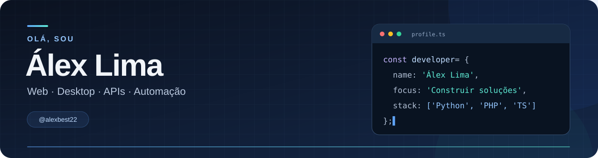
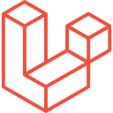
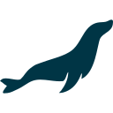
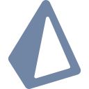

  

  <strong>Transformando processos do dia a dia em soluções com código.</strong>

Sou **Álex Lima**. Desenvolvo aplicações web e desktop, APIs e automações que simplificam tarefas e organizam processos.

- **Web e desktop:** interfaces, dashboards e sistemas de gestão.
- **Backend:** APIs, integrações e persistência de dados.
- **Automação:** rotinas para reduzir tarefas repetitivas.

## Linguagens e tecnologias:

### Linguagens

   &nbsp;
   &nbsp;
   &nbsp;
   &nbsp;
   &nbsp;
  

**TypeScript · JavaScript · Python · PHP · Java · Rust**

### Frontend

   &nbsp;
   &nbsp;
   &nbsp;
   &nbsp;
   &nbsp;
   &nbsp;
   &nbsp;
  

**React · Next.js · Vue.js · HTML · CSS · Tailwind CSS · jQuery · Vite**

### Backend

   &nbsp;
   &nbsp;
   &nbsp;
  

**Node.js · NestJS · Laravel · FastAPI**

### Bancos e dados

   &nbsp;
   &nbsp;
   &nbsp;
   &nbsp;
   &nbsp;
   &nbsp;
  

**PostgreSQL · MySQL · MariaDB · SQLite · Redis · Prisma · Supabase**

### Desktop, automação e ferramentas

   &nbsp;
   &nbsp;
   &nbsp;
  

**Tauri · Playwright · Docker · Git**

---

## Projetos:

| Projeto | Área | Tecnologias |
| --- | --- | --- |
| [AVA UNIFAN](https://github.com/RiosWesley/AVA-UNIFAN) | Ambiente virtual de aprendizagem | Next.js, React, TypeScript, Tailwind CSS |
| [AVA Backend](https://github.com/otaviocostao/ava-backend) | API do ambiente de aprendizagem | Node.js, NestJS, PostgreSQL, Supabase |
| [Ergo App](https://github.com/otaviocostao/ergo-app-tauri) | Aplicação desktop de ergonomia | Tauri, Rust, React, TypeScript, SQLite |
| [Consulta NFE](https://github.com/alexbest22/consulta-nfe.git) | Download automático de planilhas da SEFAZ | Python, Selenium, OCR |

## Veja mais por aqui:

No meu GitHub você encontra parte dos projetos, experimentos e repositórios que acompanho.

**[Explorar meus repositórios →](https://github.com/alexbest22?tab=repositories)**

  Álex Lima · <a href="https://github.com/alexbest22">@alexbest22</a>

