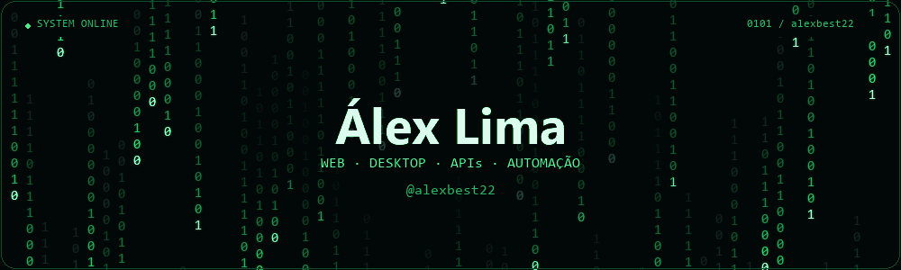

  

  <a href="#linguagens-e-tecnologias">Explorar stack</a> ·
  <a href="#projetos">Projetos</a> ·
  <a href="https://github.com/alexbest22?tab=repositories">Repositórios</a>

Sou **Álex Lima**. Desenvolvo aplicações web e desktop, APIs e automações que simplificam tarefas e organizam processos.

- **Web e desktop:** interfaces, dashboards e sistemas de gestão.
- **Backend:** APIs, integrações e persistência de dados.
- **Automação:** rotinas para reduzir tarefas repetitivas.

## Linguagens e tecnologias:

Abra as áreas abaixo para explorar as tecnologias.

<strong>Linguagens — Python, PHP, Java e mais</strong>

 

<table width="100%">
  <tr>
    <td align="center" width="25%">
       
      <strong>TypeScript</strong>
    </td>
    <td align="center" width="25%">
       
      <strong>JavaScript</strong>
    </td>
    <td align="center" width="25%">
       
      <strong>Python</strong>
    </td>
    <td align="center" width="25%">
       
      <strong>PHP</strong>
    </td>
  </tr>
  <tr>
    <td align="center" width="25%">
       
      <strong>Java</strong>
    </td>
    <td align="center" width="25%">
       
      <strong>Rust</strong>
    </td>
    <td colspan="2"></td>
  </tr>
</table>

<strong>Frontend — interfaces para a web</strong>

 

<table width="100%">
  <tr>
    <td align="center" width="25%">
       
      <strong>React</strong>
    </td>
    <td align="center" width="25%">
       
      <strong>Next.js</strong>
    </td>
    <td align="center" width="25%">
       
      <strong>Vue.js</strong>
    </td>
    <td align="center" width="25%">
       
      <strong>HTML</strong>
    </td>
  </tr>
  <tr>
    <td align="center" width="25%">
       
      <strong>CSS</strong>
    </td>
    <td align="center" width="25%">
       
      <strong>Tailwind CSS</strong>
    </td>
    <td align="center" width="25%">
       
      <strong>jQuery</strong>
    </td>
    <td align="center" width="25%">
       
      <strong>Vite</strong>
    </td>
  </tr>
</table>

<strong>Backend — APIs e integrações</strong>

 

<table width="100%">
  <tr>
    <td align="center" width="25%">
       
      <strong>Node.js</strong>
    </td>
    <td align="center" width="25%">
       
      <strong>NestJS</strong>
    </td>
    <td align="center" width="25%">
       
      <strong>Laravel</strong>
    </td>
    <td align="center" width="25%">
       
      <strong>FastAPI</strong>
    </td>
  </tr>
</table>

<strong>Bancos e dados — persistência e cache</strong>

 

<table width="100%">
  <tr>
    <td align="center" width="25%">
       
      <strong>PostgreSQL</strong>
    </td>
    <td align="center" width="25%">
       
      <strong>MySQL</strong>
    </td>
    <td align="center" width="25%">
       
      <strong>MariaDB</strong>
    </td>
    <td align="center" width="25%">
       
      <strong>SQLite</strong>
    </td>
  </tr>
  <tr>
    <td align="center" width="25%">
       
      <strong>Redis</strong>
    </td>
    <td align="center" width="25%">
       
      <strong>Prisma</strong>
    </td>
    <td align="center" width="25%">
       
      <strong>Supabase</strong>
    </td>
    <td colspan="1"></td>
  </tr>
</table>

<strong>Desktop, automação e ferramentas</strong>

 

<table width="100%">
  <tr>
    <td align="center" width="25%">
       
      <strong>Tauri</strong>
    </td>
    <td align="center" width="25%">
       
      <strong>Playwright</strong>
    </td>
    <td align="center" width="25%">
       
      <strong>Docker</strong>
    </td>
    <td align="center" width="25%">
       
      <strong>Git</strong>
    </td>
  </tr>
</table>

---

## Projetos:

| Projeto | Área | Tecnologias |
| --- | --- | --- |
| [AVA UNIFAN](https://github.com/RiosWesley/AVA-UNIFAN) | Ambiente virtual de aprendizagem | Next.js, React, TypeScript, Tailwind CSS |
| [AVA Backend](https://github.com/otaviocostao/ava-backend) | API do ambiente de aprendizagem | Node.js, NestJS, PostgreSQL, Supabase |
| [Ergo App](https://github.com/otaviocostao/ergo-app-tauri) | Aplicação desktop de ergonomia | Tauri, Rust, React, TypeScript, SQLite |
| [Consulta NFE](https://github.com/alexbest22/consulta-nfe.git) | Download automático de planilhas da SEFAZ | Python, Selenium, OCR |

## Veja mais por aqui:

No meu GitHub você encontra parte dos projetos, experimentos e repositórios que acompanho.

**[Explorar meus repositórios →](https://github.com/alexbest22?tab=repositories)**

  Álex Lima · <a href="https://github.com/alexbest22">@alexbest22</a>

