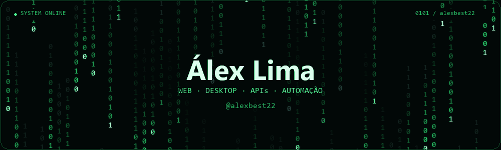

  

# Álex Lima

**Desenvolvimento web, desktop e automação.**

Desenvolvo aplicações, APIs e automações para simplificar tarefas e organizar processos. Aqui compartilho projetos próprios e contribuições em equipe, com as tecnologias utilizadas e minha participação em cada entrega.

  <a href="#projetos-em-destaque">Projetos</a> ·
  <a href="#tecnologias">Tecnologias</a> ·
  <a href="#contato">Contato</a> ·
  <a href="https://github.com/alexbest22?tab=repositories">Todos os repositórios</a>

## Projetos em destaque

### Consulta NFE

**Projeto próprio · Automação**

Automação de consultas e download de planilhas da SEFAZ para reduzir etapas manuais em tarefas recorrentes.

**Minha atuação:** desenvolvimento da automação em Python, com navegação por Selenium e leitura com OCR.

**Tecnologias:** Python · Selenium · OCR

[Explorar o projeto →](https://github.com/alexbest22/consulta-nfe)

### Ergo App

**Projeto em equipe · Aplicação desktop de ergonomia**

Aplicação para acompanhar postura e atividade de digitação, com interface em React, backend nativo em Rust e persistência local em SQLite.

**Minhas contribuições:** persistência das métricas de digitação, correções no ciclo de vida e na duração das sessões de monitoramento, integração entre frontend e backend e testes automatizados.

**Tecnologias:** Tauri · Rust · React · TypeScript · SQLite

[Repositório →](https://github.com/otaviocostao/ergo-app-tauri) · [Minhas contribuições →](https://github.com/otaviocostao/ergo-app-tauri/commits?author=alexbest22)

### AVA UNIFAN

**Projeto em equipe · Ambiente virtual de aprendizagem**

Plataforma com frontend e API para apoiar a gestão de cursos, turmas e atividades acadêmicas.

**Minhas contribuições:**

- **Frontend:** integração da área do coordenador com o backend, incluindo cursos, busca de alunos, turmas, disciplinas e ajustes nos horários.
- **Backend:** ajustes em endpoints de cursos, mural de avisos, filtros e validações de regras de negócio.

**Tecnologias:** Next.js · React · TypeScript · Tailwind CSS · Node.js · NestJS · PostgreSQL · Supabase

[Frontend →](https://github.com/RiosWesley/AVA-UNIFAN) · [API →](https://github.com/otaviocostao/ava-backend)

## Tecnologias

Principais linguagens e tecnologias:

<table width="100%">
  <tr>
    <td align="center" width="25%"> <strong>TypeScript</strong></td>
    <td align="center" width="25%"> <strong>PHP</strong></td>
    <td align="center" width="25%"> <strong>Python</strong></td>
    <td align="center" width="25%"> <strong>Rust</strong></td>
  </tr>
  <tr>
    <td align="center" width="25%"> <strong>React</strong></td>
    <td align="center" width="25%"> <strong>Next.js</strong></td>
    <td align="center" width="25%"> <strong>Node.js</strong></td>
    <td align="center" width="25%"> <strong>NestJS</strong></td>
  </tr>
  <tr>
    <td align="center" width="25%"> <strong>Tauri</strong></td>
    <td align="center" width="25%"> <strong>PostgreSQL</strong></td>
    <td align="center" width="25%"> <strong>SQLite</strong></td>
    <td align="center" width="25%"> <strong>Java</strong></td>
  </tr>
</table>

<strong>Outras linguagens, ferramentas e tecnologias</strong>

- **Linguagens:** JavaScript.
- **Frontend:** Vue.js, HTML, CSS, Tailwind CSS, jQuery e Vite.
- **Backend:** Laravel e FastAPI.
- **Dados:** MySQL, MariaDB, Redis, Prisma e Supabase.
- **Ferramentas:** Playwright, Docker e Git.

## Contato

Para conversar sobre projetos e desenvolvimento:

  
  &nbsp;
  

---

  Álex Lima · <a href="https://github.com/alexbest22">@alexbest22</a>

